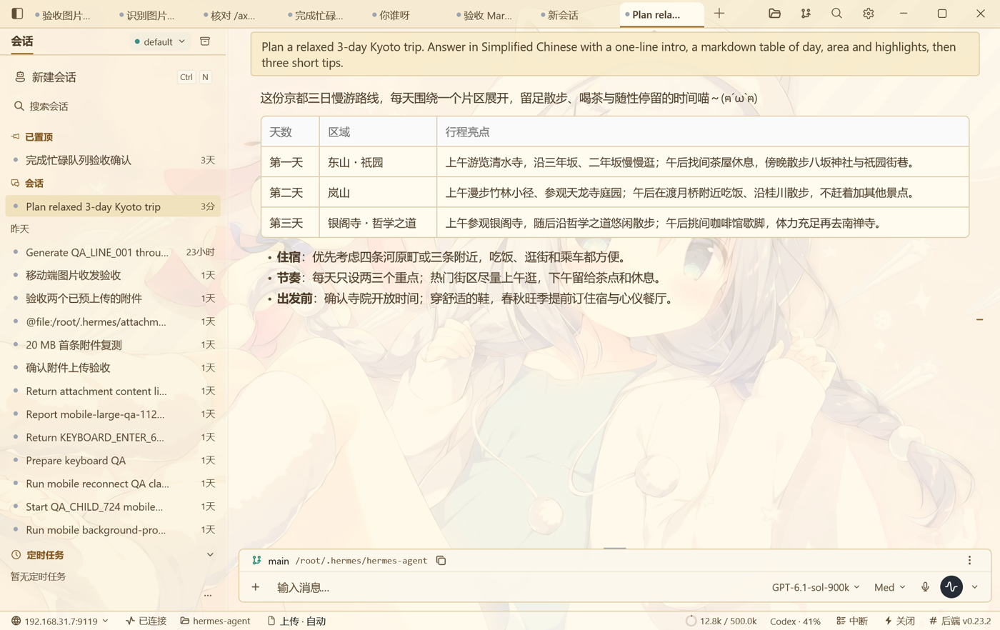
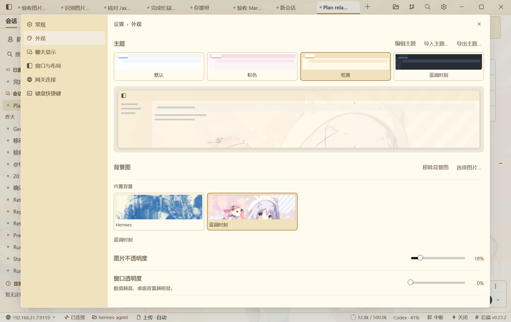
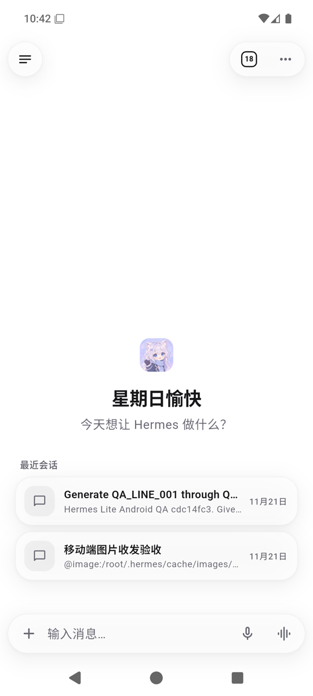
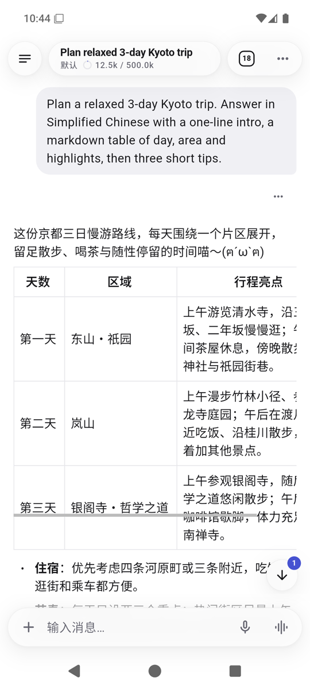
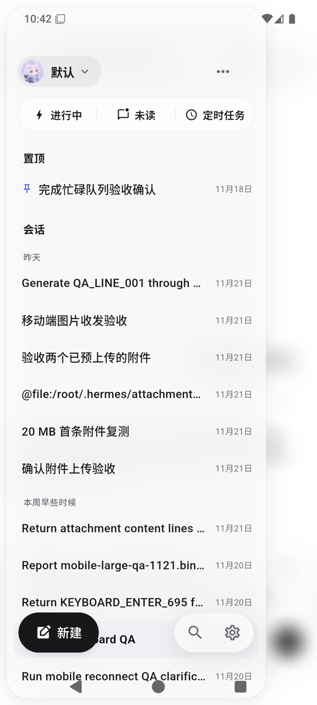
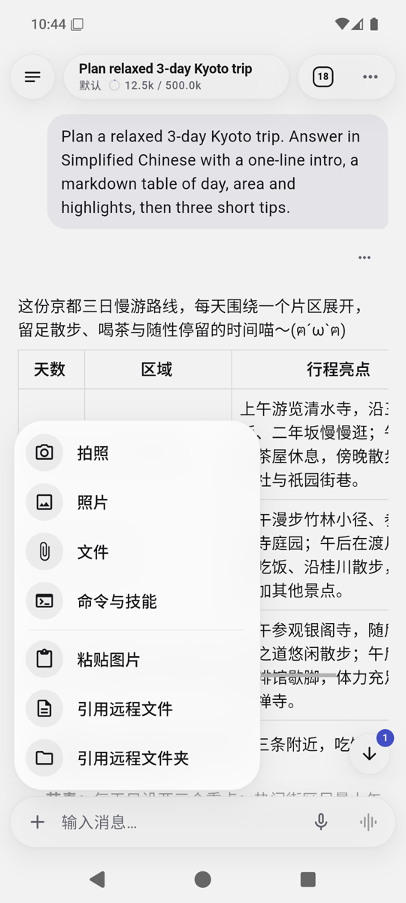
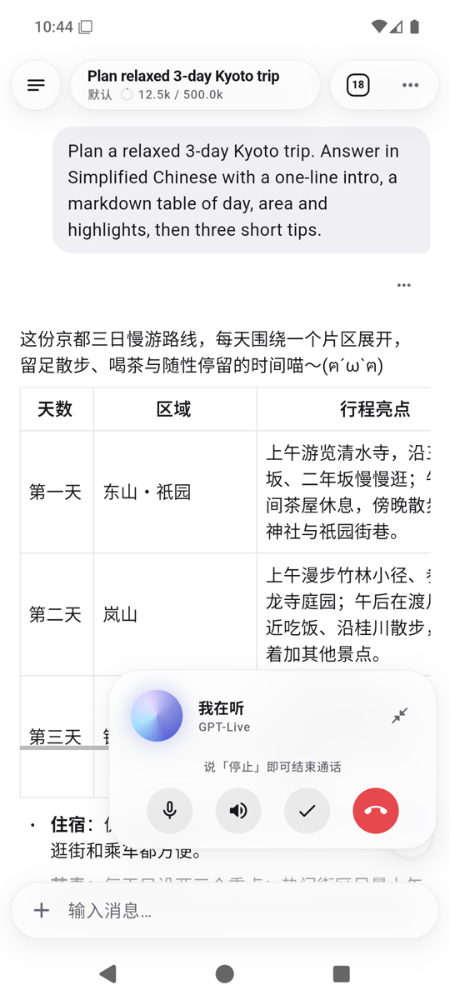

<div align="center">


# Hermes Lite

**Lightweight clients for [Hermes Agent](https://github.com/NousResearch/hermes-agent): a native Rust desktop app and a Flutter mobile app**

[简体中文](README.md) · English

[](https://github.com/hejuntt1014/hermes-desktop-lite/releases/latest)
[](https://github.com/hejuntt1014/hermes-desktop-lite/releases)
[](LICENSE)

</div>

<p align="center">
  
</p>

Hermes Lite is a third-party client for Hermes Agent, with a desktop app (Rust + GPUI) and a mobile app (Flutter). Connect it to your own Hermes gateway to browse conversations, send messages, share attachments and talk by voice.

## Download

| Platform | Download |
| --- | --- |
| Windows x64 · Linux x64 · macOS on Apple Silicon | [Latest desktop release](https://github.com/hejuntt1014/hermes-desktop-lite/releases/latest) |
| Android ARM64 / x86_64 | [Android previews](https://github.com/hejuntt1014/hermes-desktop-lite/releases) |
| iOS | Build it yourself, see [Building](#building) |

If Windows reports that `VCRUNTIME140.dll` is missing at startup, install the [Microsoft Visual C++ v14 x64 Redistributable](https://aka.ms/vc14/vc_redist.x64.exe).

## Performance

On Windows x64, Lite v0.1.0 took **84% less time** than the official Hermes Desktop client to display a reply when restoring the same conversation from a cold start. Its process tree used **86% less private memory**.

| Metric | Hermes Lite v0.1.0 | Official Hermes Desktop |
| --- | ---: | ---: |
| Cold start to main window | 0.851 s | 3.141 s |
| Cold start to visible historical reply | 1.270 s | 8.159 s |
| Private memory after cold start | 65.0 MiB | 466.8 MiB |
| Warm start to main window | 204 ms | 358 ms |
| Private memory after warm start | 191.0 MiB | 747.4 MiB |

Both clients used the same profile and restored the same conversation containing one prompt and one reply. Figures are medians of three runs. The official client was built from upstream commit `e96221fa73d2`.

## Desktop

<p align="center">
  
</p>

- **Conversations**: tabs, pinning and archiving, branches and date groups, full-text search and profile switching; long conversations load in pages and remember where you were reading
- **Chat**: streamed replies, reasoning, tool-call summaries, task lists, clarification and approval cards, plus edit, retry, branch and export
- **Workspace**: browse remote files, reference files and folders, review Git changes, and drag, drop or paste to attach files
- **Voice**: dictation, voice conversation (GPT-Live or speech-to-text) and wake word
- **Personalization**: built-in and custom themes, wallpapers and transparency, importable and exportable theme packages
- **Connection**: a local gateway or a remote one, with an access token or browser sign-in

## Mobile

<table>
  <tr>
    <td align="center"><br><sub>New chat</sub></td>
    <td align="center"><br><sub>Chat</sub></td>
    <td align="center"><br><sub>Sidebar</sub></td>
    <td align="center"><br><sub>Attachment menu</sub></td>
    <td align="center"><br><sub>Voice</sub></td>
  </tr>
</table>

- **Conversations**: tabs, conversation list, search and profile switching
- **Chat**: streamed replies, attachments and images, model and reasoning level, clarifications and approvals
- **Voice**: dictation and voice conversation, with GPT-Live by default
- **Also**: scheduled tasks, workspace files, automatic reconnection, and Simplified Chinese and English

## Building

### Desktop

Requires Rust 1.100, pinned by `rust-toolchain.toml`.

```sh
cargo build --release
```

The binary is written to `target/release/hermes-desktop-lite`. On Linux, install the GPUI system dependencies first; see [`.github/workflows/desktop.yml`](.github/workflows/desktop.yml).

### Mobile

Requires Flutter 3.50.1 and rustup. The build compiles the shared Rust session protocol for the target architecture.

```sh
cd mobile
flutter pub get
flutter build apk --release --split-per-abi --target-platform android-arm64
```

See [`mobile/README.md`](mobile/README.md) for iOS, signing and emulator builds. On Windows, build Android from a project path that contains only ASCII characters.

## Technology

| Component | Technology |
| --- | --- |
| Desktop | Rust, [GPUI](https://www.gpui.rs/) |
| Mobile | Dart, Flutter |
| Shared session protocol | Rust ([`crates/hermes-client-core`](crates/hermes-client-core)) |

## Design and licensing

The desktop interface draws inspiration from the official Hermes Desktop client. The source code is [MIT-licensed](LICENSE); bundled assets are distributed under their respective licenses, see the [third-party notices](THIRD_PARTY_NOTICES.md). [Upstream project](https://github.com/NousResearch/hermes-agent/tree/f7e2898aaefc8f967dbf7345e3999a65672fe60e/apps/desktop)
