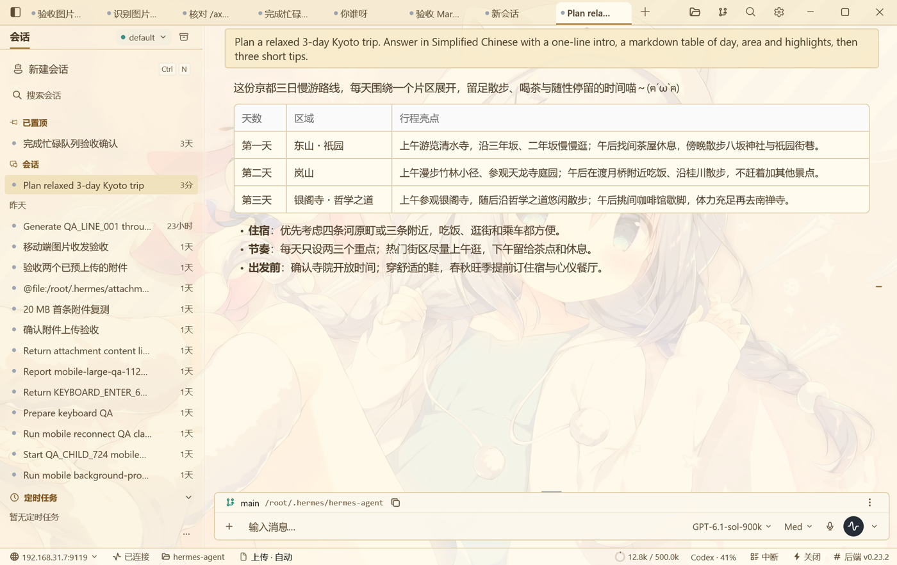
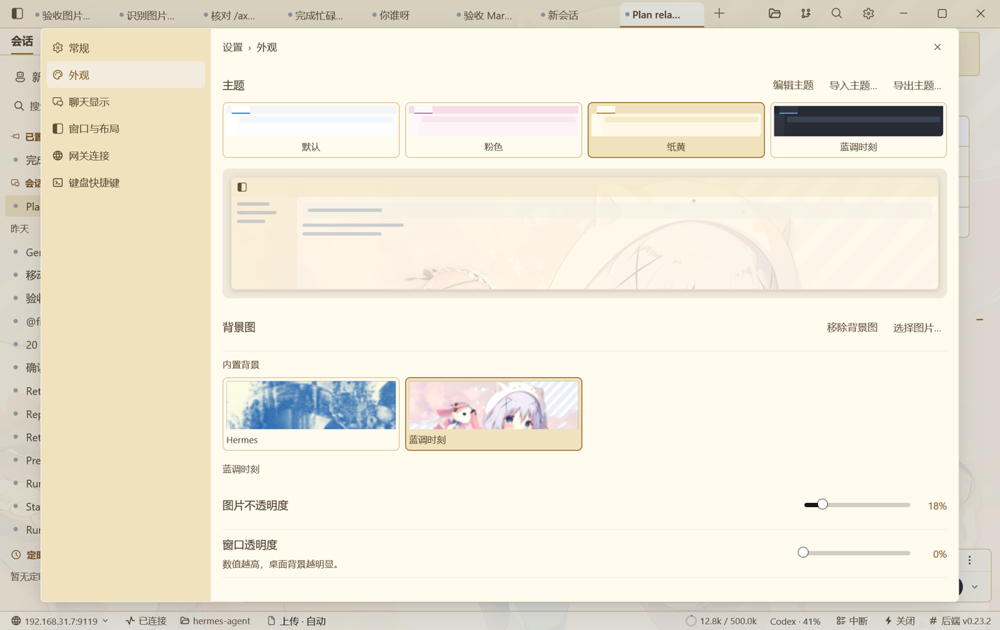
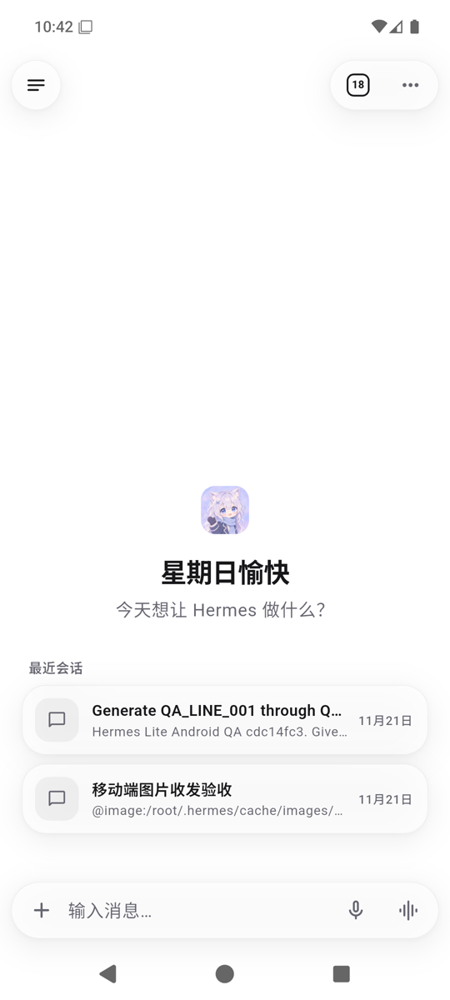
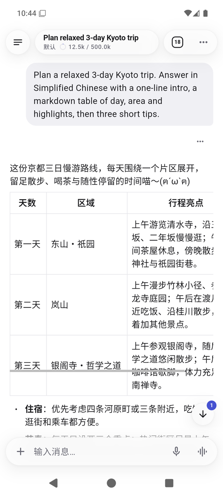
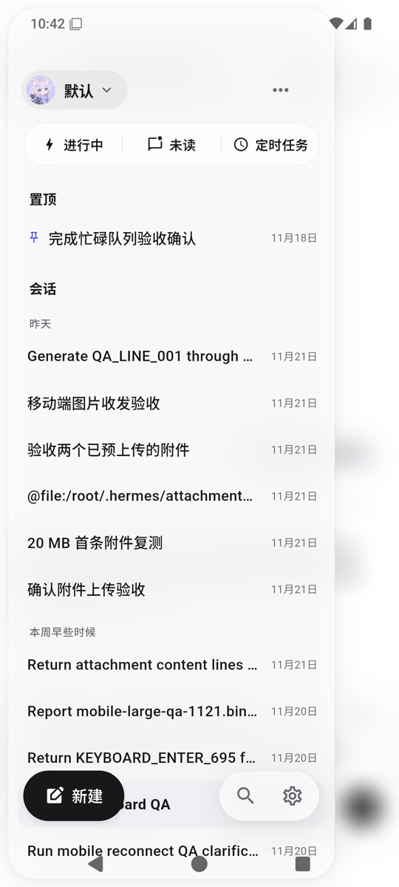
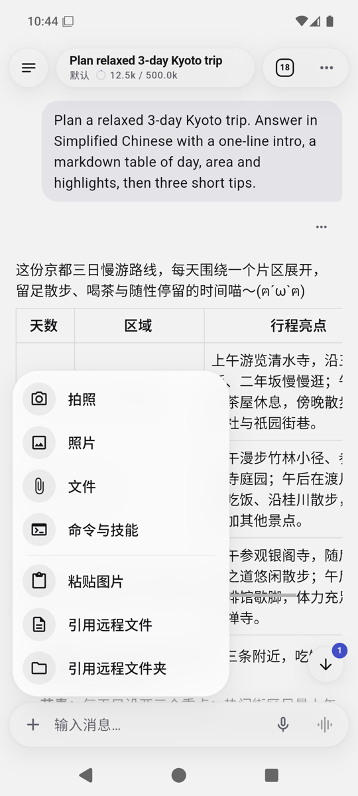
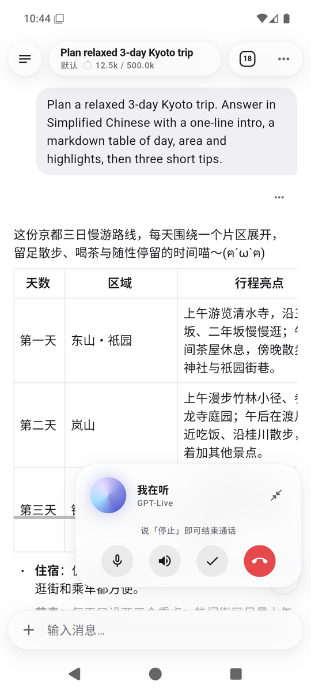

<div align="center">


# Hermes Lite

**[Hermes Agent](https://github.com/NousResearch/hermes-agent) 的轻量客户端：Rust 原生桌面端 + Flutter 移动端**

简体中文 · [English](README.en.md)

[](https://github.com/hejuntt1014/hermes-desktop-lite/releases/latest)
[](https://github.com/hejuntt1014/hermes-desktop-lite/releases)
[](LICENSE)

</div>

<p align="center">
  
</p>

Hermes Lite 是 Hermes Agent 的第三方客户端，包含桌面端（Rust + GPUI）和移动端（Flutter）。连接自己的 Hermes 网关后，可以浏览会话、收发消息、上传附件和进行语音对话。

## 下载

| 平台 | 下载 |
| --- | --- |
| Windows x64 · Linux x64 · macOS Apple Silicon | [最新桌面端](https://github.com/hejuntt1014/hermes-desktop-lite/releases/latest) |
| Android ARM64 / x86_64 | [Android 预览版](https://github.com/hejuntt1014/hermes-desktop-lite/releases) |
| iOS | 需自行构建，见[构建](#构建) |

Windows 启动时若提示缺少 `VCRUNTIME140.dll`，请安装 [Microsoft Visual C++ v14 x64 可再发行组件](https://aka.ms/vc14/vc_redist.x64.exe)。

## 性能

在 Windows x64 上冷启动并恢复同一会话，Lite v0.1.0 显示历史回复的耗时比官方 Hermes Desktop **缩短 84%**，进程树专用内存**减少 86%**。

| 指标 | Hermes Lite v0.1.0 | 官方 Hermes Desktop |
| --- | ---: | ---: |
| 冷启动至主窗口出现 | 0.851 秒 | 3.141 秒 |
| 冷启动至历史回复可见 | 1.270 秒 | 8.159 秒 |
| 冷启动后专用内存 | 65.0 MiB | 466.8 MiB |
| 热启动至主窗口出现 | 204 毫秒 | 358 毫秒 |
| 热启动后专用内存 | 191.0 MiB | 747.4 MiB |

两个客户端使用同一 Profile，恢复同一个仅含一问一答的会话，数据取三轮测量的中位数。官方客户端基于上游提交 `e96221fa73d2` 构建。

## 桌面端

<p align="center">
  
</p>

- **会话**：多标签、置顶与归档、分支和日期分组、全文搜索、按档案切换，长会话分页加载并记住阅读位置
- **对话**：流式回复、思考过程、工具调用摘要、任务清单、澄清与审批卡片，支持编辑、重试、分叉和导出
- **工作区**：浏览远程文件、引用文件和文件夹、审查 Git 变更，拖放或粘贴即可添加附件
- **语音**：听写、语音对话（GPT-Live 或语音转文字）、语音唤醒
- **个性化**：内置与自定义主题、背景图和透明度、可导入导出的主题包
- **连接**：本地网关或远程网关，支持访问令牌与浏览器登录

## 移动端

<table>
  <tr>
    <td align="center"><br><sub>新会话</sub></td>
    <td align="center"><br><sub>聊天</sub></td>
    <td align="center"><br><sub>侧栏</sub></td>
    <td align="center"><br><sub>附件菜单</sub></td>
    <td align="center"><br><sub>语音对话</sub></td>
  </tr>
</table>

- **会话**：标签页、会话列表、搜索、档案切换
- **对话**：流式回复、附件和图片、模型与推理档位、澄清与审批
- **语音**：听写和语音对话，默认使用 GPT-Live
- **其他**：定时任务、工作区文件、断线自动重连，支持简体中文和 English

## 构建

### 桌面端

需要 Rust 1.100（由 `rust-toolchain.toml` 固定）。

```sh
cargo build --release
```

产物位于 `target/release/hermes-desktop-lite`。Linux 需先安装 GPUI 的系统依赖，可参考 [`.github/workflows/desktop.yml`](.github/workflows/desktop.yml)。

### 移动端

需要 Flutter 3.50.1 和 rustup，构建时会为目标架构编译共享的 Rust 会话协议。

```sh
cd mobile
flutter pub get
flutter build apk --release --split-per-abi --target-platform android-arm64
```

更多说明（iOS、签名、模拟器）见 [`mobile/README.md`](mobile/README.md)。在 Windows 上构建 Android 时，项目路径需只含 ASCII 字符。

## 技术栈

| 模块 | 技术 |
| --- | --- |
| 桌面端 | Rust、[GPUI](https://www.gpui.rs/) |
| 移动端 | Dart、Flutter |
| 共享会话协议 | Rust（[`crates/hermes-client-core`](crates/hermes-client-core)） |

## 设计与许可

桌面端界面风格借鉴自官方 Hermes Desktop。源码采用 [MIT 许可证](LICENSE)，随附素材按各自的许可分发，见[第三方声明](THIRD_PARTY_NOTICES.md)。[上游项目](https://github.com/NousResearch/hermes-agent/tree/f7e2898aaefc8f967dbf7345e3999a65672fe60e/apps/desktop)
